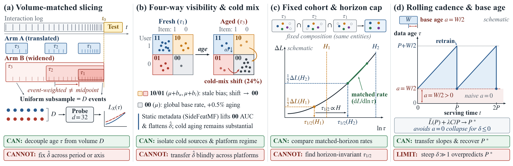

# How Fast Does Taste Go Stale? Measuring Data Aging in Recommenders, and When You Cannot

Official code, run records (`6,681` fixed-budget runs), and technical appendix for the **WSDM 2027** paper (February 15–19, 2027, Hong Kong, Hong Kong).

- **Venue:** Proceedings of the Twentieth ACM International Conference on Web Search and Data Mining (**WSDM 2027**)
- **DOI:** [10.1145/3862322.3863817](https://doi.org/10.1145/3862322.3863817)
- **Technical Appendix:** [Technical Appendix & Full Tables](supplement/supplement.pdf) ([LaTeX source](supplement/supplement.tex))



The scripts below reproduce all primary tables, figures, and diagnostic checks directly from the included run records. This README also documents the exact hyperparameters, window grids, and control schedules referenced in the WSDM 2027 paper and [technical appendix](supplement/supplement.pdf).

## Layout

```text
src/          training, preparation, figure builders, and analysis scripts
results/      per-run records (JSONL), fit outputs (JSON), blind-round registrations
supplement/   compiled technical appendix (supplement.pdf), supplement.tex, and figs/
assets/       overview diagram preview (overview.png)
```

Key files:

| File | Role |
|---|---|
| `src/train.py` | probe training (one run = one record) |
| `src/run_domain.py` | per-domain age-manipulation grids (the `DOMAINS` dict) |
| `src/run_periods.py` | test-period sweep driver |
| `src/fit_domains.py` | Box–Cox age-law fits → `results/delta_dictionary*.json` |
| `src/collapse.py` | cohort curves, τ½, truncation tests → `results/collapse_fit.json` |
| `src/two_term_law.py` | warm/cold two-term decomposition → `results/two_term_fits.json` |
| `src/period_analysis.py` | test-period sensitivity → `results/period_analysis.json` |
| `src/backtest.py`, `src/backtest_baselines.py`, `src/backtest_analysis.py` | rolling-retrain backtest and policy baselines |
| `src/blind_predict.py`, `src/blind_predict2.py` | blind rounds 1 and 2 |
| `src/paper_numbers.py` | aggregates baseline summaries and run census (`5,296` baseline + `1,385` extended = `6,681` total) → `results/paper_numbers.json` |
| `src/age_diagnostics.py` | warm/cold attribution, Game-UGC redraws, and cadence comparisons → `results/age_diagnostics.json` |
| `src/fig_overview.py` | renders Figure 1 (`paper/figs/fig0_overview.pdf` and `assets/overview.png`; pass `--pptx` for editable PowerPoint) |
| `src/paper_figs.py` | regenerates paper Figures 2–5 and appendix Figures S1–S2 into `paper/figs/` from fit outputs |
| `src/cr_lib.py`, `src/stage1_zero_run.py`–`src/stage5_gameugc_hygiene.py` | extended diagnostic suite (four-way warm/cold partition, strict zero-overlap multi-domain backtests, side-feature two-tower controls, Game-UGC multi-draw/validation-stopping/1-day grid, and training-free cohort-density & autocorrelation checks) → `results/stage1_zero_run.json`, `results/stage*_summary.json` |
| `src/camera_ready_reproduce.py` | offline verification of all 33 extended-diagnostic JSONLs (`1,385` runs) and Stage 1–5 summary JSONs from `results/` alone |

## Quickstart: reproducing the paper's numbers and figures

Requires Python ≥ 3.9 (tested on Python 3.9 and 3.10). Install dependencies via:

```bash
pip install -r requirements.txt
```

Offline analysis and figure rendering require no GPU:

```bash
python src/paper_numbers.py          # primary summaries and census (5,296 baseline + 1,385 extension = 6,681)
python src/age_diagnostics.py        # cold shares, both Game-UGC cohorts, observed and interpolated optima
python src/camera_ready_reproduce.py # offline verification of all 33 extended-diagnostic JSONLs (1,385 runs)
python src/paper_figs.py             # re-renders Figures 2–5 and appendix Figures S1–S2 into paper/figs/
python src/fig_overview.py           # re-renders Figure 1 (paper/figs/fig0_overview.pdf) & assets/overview.png
```

**Offline reproduction note:** `paper_numbers.py` (except for its event-weighted age table), `age_diagnostics.py`, `camera_ready_reproduce.py`, `stage2_fourway_cold.py --summary-only`, `stage3_backtests.py --summary-only`, and `stage5_gameugc_hygiene.py --summary-only` run directly from `results/` without raw data. Rerunning `stage1_zero_run.py`, `stage4_side_features.py` (which reads raw metadata caches not redistributed in `results/`), or any training grid requires the prepared `.npz` archives in `data/`.

Rerunning a single domain end-to-end (requires the prepared `.npz` file [see below]; a single
GTX 1660-class GPU suffices):

```bash
python src/run_domain.py kuairand
```

The study census totals **6,681** training runs: **5,296** in the baseline GPU sweep (2,229 primary across 68 settings, 1,728 test-period, 526 backtest and policy, 777 convention-robustness reruns, and 36 weekday, excluding 98 early exploratory runs) plus **1,385** in the extended CPU diagnostic suite:

- **522** four-way warm/cold (`11`/`10`/`01`/`00`) runs across all 23 domains (`results/fourway_*.jsonl`)
- **296** strictly non-overlapping rolling-retrain backtest runs across RecFlow (19 d, `backtest_recflow_nooverlap19d.jsonl`, 80 runs), KuaiRand (22 d, `backtest_kuairand_strict.jsonl`, 90 runs), and Game-UGC finish (32 d, `backtest_gameugc_strict.jsonl`, 126 runs)
- **114** static side-feature two-tower (`SideFeatMF`) control runs across KuaiRand, RecFlow, and MovieLens-25M (`results/sidefeat_*.jsonl`)
- **453** game-UGC cohort-hygiene and validation-stopping runs (`gameugc_finish__icohort_draws.jsonl` [231], `gameugc_finish__valstop.jsonl` [60], `gameugc_finish__icohort_valstop.jsonl` [66], `gameugc_finish__icohort_finegrid.jsonl` [96])

The original GPU sweep took roughly 40 GPU hours on one GTX 1660 (6 GB); any single domain reproduces in under an hour, and the extended CPU `SparseAdam` diagnostic runs completed in under a day with `OMP_NUM_THREADS=2`. Completed (window, seed) cells are skipped on restart.

## Datasets

Raw datasets are **not** redistributed. `src/prep_*.py` converts each
public release into the standard `.npz` schema
(`user`, `item`, `label`, `ts`):

- MovieLens-25M — grouplens.org/datasets/movielens/25m
- Netflix Prize — archived Kaggle mirror
- Yelp Open Dataset — yelp.com/dataset
- Amazon Reviews 2023 (12 categories) — amazon-reviews-2023.github.io
- Steam reviews (Kaggle 2021), BeerAdvocate, Epinions — public mirrors
- KuaiRand-Pure, KuaiRec 2.0, RecFlow — the respective project pages

The industrial game-UGC log cannot be redistributed under our aggregate-reporting
agreement; however, its **derived per-run measurements** (losses, coverage, and
run metadata, none of which can be inverted to recover individual behavior) are
included as `results/domain_gameugc_*.jsonl`, `results/fourway_gameugc_*.jsonl`,
`results/gameugc_finish__*.jsonl`, and `results/backtest_gameugc_strict.jsonl`.

## Exact hyperparameters (WSDM 2027 paper §3 / Appendix §S1)

Probe (biased matrix factorization), default settings for the primary grids
unless otherwise stated:

- Model: `y = mu + b_u + b_i + <p_u, q_i>`, embedding dimension `d = 32`
  (capacity sweep: `d ∈ {8, 32, 64, 128}` on feed cohorts and `{32, 64}` on
  MovieLens-25M), embeddings initialized from `N(0, 0.01²)`
- Loss: binary cross-entropy with logits; optimizer: `SparseAdam` on embedding
  tables, dense `Adam` on scalar parameters; learning rate `3e-3`
- Batch size: `8,192`; budget: `≤ 8,000` steps; test loss evaluated every
  `200` steps (every `50` steps on day-scale domains), reporting the best
  early-stopping checkpoint
- Divergence rule: runs whose test loss remains above `ln 2` are flagged as
  diverged and retuned
- Invariance MLP: concatenates `[p_u; q_i; p_u ⊙ q_i]` into a 64-unit
  ReLU head (`lr = 1e-3` on million-item catalogs)
- Side-feature control (`SideFeatMF`, `src/stage4_side_features.py`): additive
  user/item metadata embeddings (`d = 32` + scalar bias via `nn.EmbeddingBag`,
  sparse author table, or linear genre projection) added to ID representations
  under the same training budget and `lr = 3e-3` on KuaiRand, RecFlow, and
  MovieLens-25M (`results/sidefeat_*.jsonl`)

## Window grids (WSDM 2027 paper §3)

The `DOMAINS` dictionary in `src/run_domain.py` defines the authoritative per-domain grids:

- **Time units and test windows**: days on the four feed logs and months elsewhere; the test period spans the final 2–6 units.
- **Manipulations**: translated windows (Arm A) of fixed width (`2–3 d` on feeds or `2–24 mo` elsewhere) shifted backward by log-spaced gaps (up to `512 d` on feeds / `192 mo` on reviews), and widened windows (Arm B) anchored at the test boundary with log-spaced spans.
- **Subsampling**: every window within a domain is uniformly subsampled to a common event count `D` (`27K`–`300K` across surviving domains; survival floor `25K`, cap `300K`).
- **Seeds**: 3 model seeds per cell by default and 9 for primary non-Amazon cohort curves (Amazon item cohorts and redraw controls use 3); cohort runs fix the subsample seed (bit-identical training data across model seeds) and evaluate Arm A only.

**Arm-naming note:** For historical reasons, the code and JSONL records label the two
manipulations `"A"` (translated) and `"C"` (widened), whereas the paper calls them Arms A and B (`"C"` in records corresponds to Arm B in the paper).

## Control schedules (WSDM 2027 paper §5 / §7)

- **Weekday control**: `W = 7` d windows, gaps 0, 1, 2, 4, 8, 13 d, same
  subsample size, 3 seeds (driver: `src/control_weekday.py`)
- **Prior-shift (calibration) control**: one scalar logit offset fitted on
  the last time unit before the test boundary, capped at 50,000 events
- **Capacity sweep**: `d ∈ {8, 32, 64, 128}` on KuaiRand and RecFlow cohorts,
  and `d ∈ {32, 64}` on MovieLens-25M (`*__dim*.jsonl`)

## Fitting details ([Technical Appendix §S1](supplement/supplement.pdf))

For fixed δ, the Box–Cox age law is linear in the per-arm intercepts and β: we locate δ
via a 241-node grid scan over the registered parameter bounds `[-1, 4]`
(with golden-section refinement) and solve the linear subproblem exactly subject to
`β ≥ 0`. Ninety-percent CIs use a 300-draw percentile bootstrap over runs within each `(manipulation, age)`
cell. Fits landing within `1e-3` of a δ bound are flagged *at bound* and refit over
the wider bounds `[-6, 4]`; curves requiring `β < 0` are flagged *descending*.
Under pre-stated quality control, fits with `β < 1e-6` or `R² < 0.2` are labeled `"no measurable drift."` The half-rise time τ½
interpolates in log-age between the first two cells bracketing half of the endpoint
loss increase (200-draw bootstrap), after dropping degenerate cells (cohort loss `> 1` nat) and
curves whose range falls below twice the median seed noise. Hill fits are
profiled over θ and reported only when `T ∈ [τ_min/2, 2 τ_max]`, θ is interior,
the curve decelerates, and `A > 0` (6 of 33 cohort curves qualify).

## Blind-round registrations

Predictions were frozen prior to any model training on the held-out categories, with Round-2 revisions logged in our internal archive (no independent external timestamp exists). The SHA-256 digests below verify the exact files distributed in this archive:

| File | SHA-256 |
|---|---|
| `results/blind_predictions.json` (round 1) | `0456e235491953830593fa417e53b73ab65bc526d75b9f3f49748902931dc3f6` |
| `results/blind_predictions_round2_v1.json` (round 2, revision 1) | `c1ad0d356e091682c68847b8f3d693b09985bb215f75f4c262b6cd3fc2b05a76` |
| `results/blind_predictions_round2.json` (round 2, final) | `2b9b1e0ba163a1982d28029fc5ba6dfa6f1fc7b60f2e228ca0adc5fc6e7254bc` |

## Citation

```bibtex
@inproceedings{chen2027stale,
  author    = {Chen, Minghao and Mo, Wentao and Wang, Jiali and Zhang, Xun and Liang, Zhenfeng and Zeng, Yi and Zheng, Jiale},
  title     = {How Fast Does Taste Go Stale? Measuring Data Aging in Recommenders, and When You Cannot},
  booktitle = {Proceedings of the Twentieth ACM International Conference on Web Search and Data Mining (WSDM 2027)},
  year      = {2027},
  isbn      = {979-8-4007-3117-4/2027/02},
  location  = {Hong Kong, Hong Kong},
  pages     = {},
  numpages  = {11},
  url       = {https://doi.org/10.1145/3862322.3863817},
  doi       = {10.1145/3862322.3863817},
  publisher = {Association for Computing Machinery},
  address   = {New York, NY, USA}
}
```

## License

MIT (see `LICENSE`).
